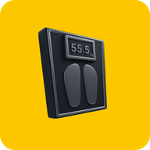
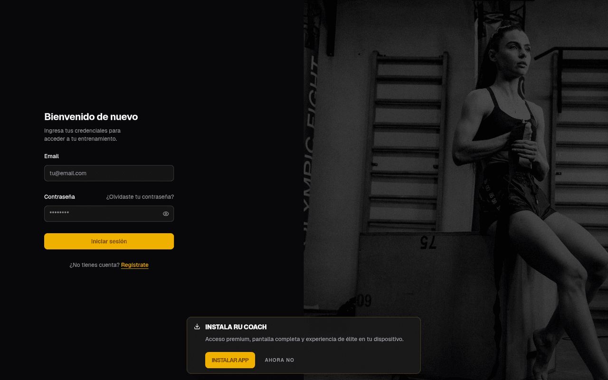
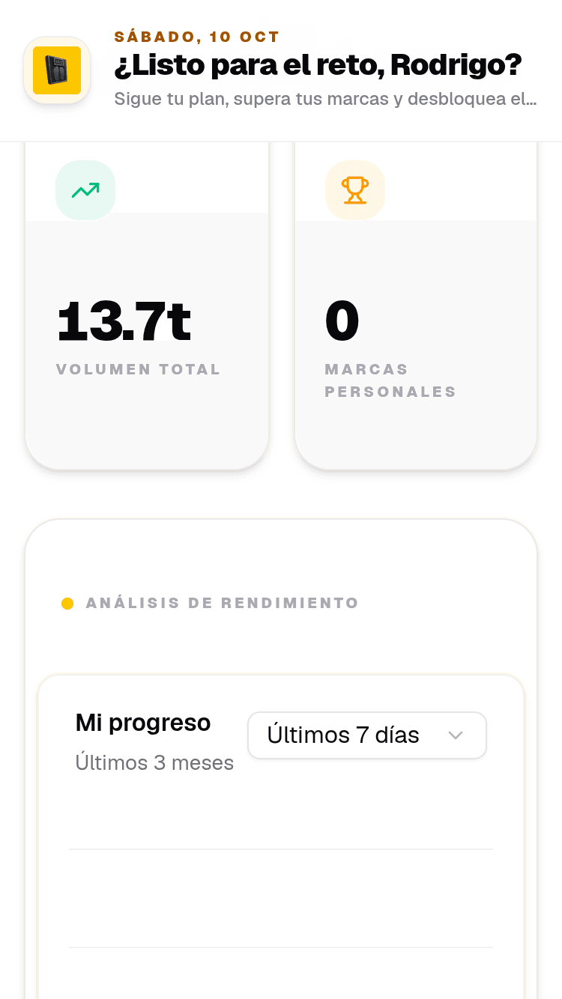
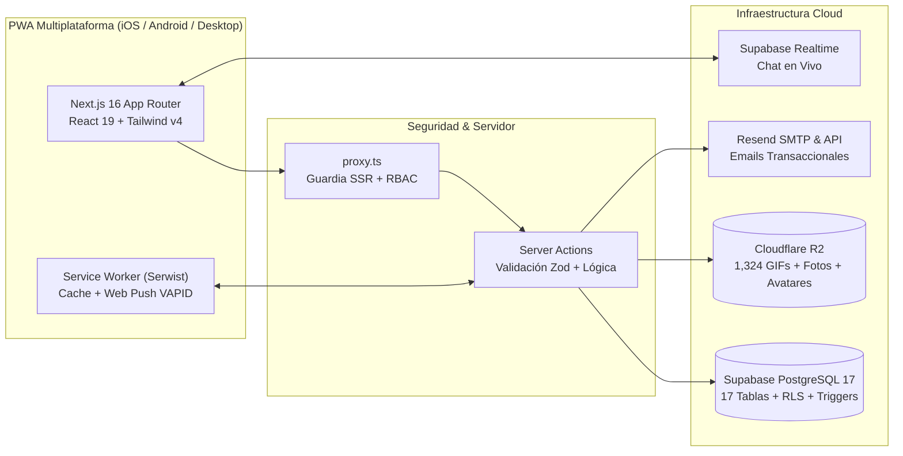

<div align="center">
  

  # RU Coach — Rodrigo Urbina Personal Coaching

  **Plataforma Web Progresiva (PWA) de Entrenamiento Personalizado, Biomecánica Aplicada y Seguimiento Deportivo de Alto Rendimiento**

  [](https://nextjs.org/)
  [](https://react.dev/)
  [](https://www.typescriptlang.org/)
  [](https://tailwindcss.com/)
  [](https://supabase.com/)
  [](https://www.cloudflare.com/)
  [](https://rucoach.app)

  [**Sitio en Producción (`rucoach.app`)**](https://rucoach.app) · [**Documentación Técnica (`docs/`)**](./docs/INDEX.md) · [**Guía de Base de Datos**](./docs/DATABASE_GUIDE.md) · [**Guía de Migración y Dominio**](./docs/MIGRACION_PRODUCCION_RUCOACH_APP.md)
</div>

---

## Vista General

**RU Coach** es una plataforma integral diseñada para centralizar todo el flujo de trabajo entre **Entrenador (Coach)**, **Asesorado (Atleta)** y **Recepción**. Combina prescripción estructurada de rutinas (con biseries, superseries y catálogo bilingüe de **1,324 ejercicios**), registro de sesiones en vivo con temporizadores hápticos/sonoros, **motor de sobrecarga progresiva automática con barrera clínica de dolor**, biometría antropométrica, comparador visual de progreso físico (*Antes / Después*), chat en tiempo real y notificaciones Web Push nativas.

<div align="center">
  <table>
    <tr>
      <td align="center" width="65%">
        
        <br />
        <sub><b>Experiencia Desktop (1440px)</b> — Panel de Control y Analítica</sub>
      </td>
      <td align="center" width="35%">
        
        <br />
        <sub><b>Experiencia Móvil PWA (iOS & Android)</b></sub>
      </td>
    </tr>
  </table>
</div>

---

## Arquitectura del Sistema



---

## Ecosistema de Módulos por Rol

### 1. Portal del Coach / Administrador (`/admin/*`)
- **Dashboard Operativo (`/admin/dashboard`)**: KPIs en tiempo real (asesorados activos, sesiones completadas en la semana, récords personales del mes, alertas de inactividad +3 días y membresías próximas a vencer), curvas de adherencia y acceso rápido por atleta.
- **Hub Clínico y Deportivo 360° del Asesorado (`/admin/clients/[clientId]`)**:
  - **Alerta Clínica de Molestias**: Banner prioritario con reportes de dolor activos (`client_pain_reports`) y resolución clínica con un clic (`resolveClientPainReport`).
  - **Pestaña Resumen**: Rachas activas, nivel/XP, datos antropométricos, tamizaje de lesiones y bloc de notas privadas del coach.
  - **Pestaña Rutina**: Desglose diario del programa activo con trazabilidad de **sustituciones de ejercicios** (`client_exercise_overrides`) y botón para restaurar el ejercicio original (`revertExerciseOverride`).
  - **Pestaña Historial**: Sesiones finalizadas con duración, tonelaje movido, series efectivas, **esfuerzo percibido post-entreno (`feeling_score` 1–5)** y comentarios del atleta (`feeling_note`).
  - **Pestaña Progreso y Físico**: Curvas de evolución de fuerza por ejercicio (`@tanstack/charts`), historial de **7 perímetros y medidas corporales** (Peso, % Grasa, Cintura, Cadera, Pecho, Brazo, Muslo) y galería privada de fotos de progreso con URLs firmadas desde Cloudflare R2.
- **Constructor Visual de Rutinas (`/admin/routines/builder`)**:
  - Diseño de programas por objetivo (`goal`), nivel (`level`), duración en semanas y distribución de días de entrenamiento/descanso.
  - Reordenamiento *Drag & Drop* (`@dnd-kit`), agrupación visual de **Biseries y Superseries (Grupos A–E)**, prescripción de series, repeticiones, carga sugerida, descanso y notas biomecánicas.
  - Asignación instantánea con notificación automática vía **Resend** y **Web Push**.
- **Catálogo Bilingüe de Ejercicios (`/admin/exercises`)**:
  - **1,324 ejercicios** con esquema bilingüe (español prioritario `_es` e inglés como respaldo), GIFs demostrativos servidos desde Cloudflare R2, clasificación por modalidad (`strength`, `bodyweight`, `timed`, `cardio`, `mobility`) y bandera `uses_external_load`.
- **Pagos, Planes y Membresías (`/admin/payments` y `/admin/settings`)**:
  - Control de pagos (`paid`, `pending`, `overdue`), actualización automática de vigencia (`membership_end_date`), recibos por correo/Push y gestor CRUD de **Planes y Tarifas (`membership_plans`)**.
- **Invitaciones y Mensajería Realtime (`/admin/invitations`, `/admin/messages`)**:
  - Códigos de invitación exclusivos para nuevos atletas o coaches y bandeja de chat en vivo con indicadores de lectura (`Check` / `CheckCheck`) y respuestas rápidas.

### 2. Portal del Asesorado / Atleta (`/client/*`)
- **Onboarding Clínico y Antropométrico en 4 Pasos (`/onboarding`)**:
  - Sincronización inteligente de datos pre-cargados por el coach, creación automática de la **medición base Día 1** en `body_measurements`, selección de objetivos y disponibilidad semanal (`2` a `6+` días/semana), **tamizaje articular/lesiones** que genera alertas clínicas automáticas y activación de notificaciones Push compatible con iOS/Android/Desktop.
- **Dashboard del Atleta (`/client/dashboard`)**: Nivel actual, barra de XP, racha de días calendario, tarjeta del entrenamiento del día, gráfica de actividad (`7d` / `30d` / `90d`) e hitos recientes.
- **Mi Rutina (`/client/routines`)**:
  - Exploración de días del programa, ficha técnica con GIF e instrucciones paso a paso, **intercambio inteligente de ejercicio** (`ExerciseSwapDrawer`) y **cambio temporal del día a entrenar hoy** (`ScheduleOverrideDialog`).
- **Sesión de Entrenamiento Activa (`/client/workout/start`)**:
  - Registro serie por serie con historial previo del ejercicio, controles táctiles de `44x44px`, soporte para biseries/superseries, temporizador flotante con alerta Web Audio API + vibración háptica y autoguardado en `localStorage`.
  - **Cierre con Sensación Post-Entreno (`1–5`)** y nota directa para el coach.
- **Resumen Post-Entrenamiento y Auto-Progresión (`/client/workout/summary`)**:
  - Desglose de series, XP obtenido, **Nuevos Récords Personales (PRs)** y modales de desbloqueo de medallas con opción de compartir (`navigator.share`).
  - **Motor de Auto-Progresión (`lib/auto-progression.ts`)**: Incrementa de forma inteligente las cargas sugeridas cuando el atleta cumple el tope de repeticiones con RPE controlado, incorporando una **barrera de seguridad clínica** que congela incrementos en tren superior o inferior si existe un reporte de dolor activo (`severity >= 4`).
- **Progreso, Medidas, Fotos, Calendario y Logros**:
  - Gráficas de fuerza/volumen (`/client/progress`), radar antropométrico de 7 métricas (`/client/measurements`), comparador interactivo **Antes / Después** (`/client/photos`), calendario mensual (`/client/calendar`) y vitrina de 16 medallas (`/client/achievements`).

### 3. Portal de Recepción (`/receptionist/*`)
- **Control de Acceso y Caja (`/receptionist/dashboard`, `/check-in`, `/clients`, `/payments`)**: Verificación inmediata de estatus de membresía, check-in diario de asistencia y consulta de pagos.

---

## Stack Tecnológico

| Capa | Tecnología |
| :--- | :--- |
| **Framework & Runtime** | Next.js `16.2` (`App Router`, React Server Components, Server Actions, `proxy.ts`) |
| **Frontend & UI** | React `19.2`, TypeScript `5`, Tailwind CSS `v4` (`@tailwindcss/postcss`), Radix UI / `shadcn/ui`, Lucide Icons |
| **Base de Datos & Auth** | Supabase (`@supabase/ssr`, PostgreSQL 17, Row Level Security con `InitPlan`, Triggers, Realtime, Storage) |
| **Almacenamiento S3 / CDN** | Cloudflare R2 (`@aws-sdk/client-s3` + Presigned URLs con validación RBAC) |
| **Visualización de Datos** | Recharts + `@tanstack/charts` |
| **PWA & Notificaciones** | `@serwist/next` (`app/sw.ts`) + Web Push Protocol (`web-push` VAPID) |
| **Correos Transaccionales** | Resend API + `@react-email/components` + Plantillas HTML de Supabase Auth |
| **Calidad & Testing** | Vitest (`vitest run`), TypeScript (`tsc --noEmit`), ESLint 9 (`pnpm lint`) |

---

## Estructura del Proyecto

```text
rucoach/
├── app/
│   ├── actions/          # 16 módulos de Server Actions (Auth, Workouts, Rutinas, R2, Push, Pagos)
│   ├── admin/            # Portal del Coach / Administrador (Dashboard, Clientes, Builder, Pagos)
│   ├── api/              # Route Handlers (Validación de invitaciones)
│   ├── auth/             # Flujos de autenticación (Login, Sign-up, OTP, Callback PKCE, Recovery)
│   ├── client/           # Portal del Asesorado (Dashboard, Rutina, Entreno Activo, Progreso, Fotos)
│   ├── onboarding/       # Onboarding clínico e interactivo del asesorado (4 pasos)
│   ├── receptionist/     # Portal operativo de recepción y check-in
│   ├── globals.css       # Sistema de tokens OKLCH (Claro/Oscuro AAA) y utilidades Tailwind v4
│   ├── layout.tsx        # Root Layout, metadatos SEO, JSON-LD y configuración PWA
│   └── sw.ts             # Service Worker (Serwist + Web Push Notifications)
├── components/           # Componentes UI modulares (admin, client, chat, charts, photos, routines, ui)
├── docs/                 # Documentación técnica, operativa y guías de migración a producción
├── emails/               # Plantillas React Email (Resend) y plantillas HTML para Supabase Auth
├── hooks/                # Custom React Hooks
├── lib/                  # Motores de negocio (auto-progression, gamification, email, push, r2, types)
├── public/               # Manifiesto PWA, iconos maskable/Apple Touch y recursos estáticos optimizados
├── scripts/              # Scripts de mantenimiento y migración (migrate-exercises.ts, translate, upload-r2)
├── supabase/             # Esquema SQL maestro replicable (supabase_schema_dump.sql) y datos semilla (seed.sql)
└── proxy.ts              # Middleware/Proxy SSR de sesión Supabase y control de acceso por rol
```

---

## Inicio Rápido y Replicación en Supabase

### 1. Clonar e instalar dependencias
```bash
git clone https://github.com/herwingx/rucoach.git
cd rucoach
pnpm install
```

### 2. Configurar variables de entorno
Copia la plantilla [`.env.example`](./.env.example) a `.env.local`:
```bash
cp .env.example .env.local
```

Variables requeridas:
- **App**: `NEXT_PUBLIC_APP_URL` (`https://rucoach.app` en producción o `http://localhost:3000` en local) y `ADMIN_SETUP_CODE`.
- **Supabase**: `NEXT_PUBLIC_SUPABASE_URL`, `NEXT_PUBLIC_SUPABASE_PUBLISHABLE_DEFAULT_KEY` (o `NEXT_PUBLIC_SUPABASE_ANON_KEY`) y `SUPABASE_SERVICE_ROLE_KEY`.
- **Cloudflare R2**: `R2_ACCOUNT_ID`, `R2_ACCESS_KEY_ID`, `R2_SECRET_ACCESS_KEY`, `R2_BUCKET_NAME`, `NEXT_PUBLIC_R2_PUBLIC_URL`.
- **Resend**: `RESEND_API_KEY` y `EMAIL_FROM` (`RU Coach <noreply@rucoach.app>`).
- **Web Push (VAPID)**: `NEXT_PUBLIC_VAPID_PUBLIC_KEY` y `VAPID_PRIVATE_KEY`.

### 3. Replicar la Base de Datos al 100% en Supabase (3 pasos nativos)
El proyecto utiliza SQL nativo de PostgreSQL 17 para soportar **Row Level Security (RLS)**, triggers sobre `auth.users`, buckets de Storage y publicaciones Realtime:

1. **Esquema Maestro**: Ejecuta [`supabase/supabase_schema_dump.sql`](./supabase/supabase_schema_dump.sql) en el **SQL Editor** de tu proyecto Supabase (crea las 17 tablas, 2 vistas, funciones RPC, triggers, índices, políticas RLS, buckets `avatars`/`progress-photos` y Realtime).
2. **Datos Semilla**: Ejecuta [`supabase/seed.sql`](./supabase/seed.sql) en el **SQL Editor** (inserta las 16 medallas de gamificación y los planes de membresía base).
3. **Catálogo de 1,324 Ejercicios**: Si estás migrando desde otra instancia de Supabase, ejecuta [`scripts/migrate-exercises.ts`](./scripts/migrate-exercises.ts):
   ```bash
   OLD_SUPABASE_URL="https://proyecto-anterior.supabase.co" \
   OLD_SUPABASE_KEY="anon_key_anterior" \
   NEW_SUPABASE_URL="https://proyecto-nuevo.supabase.co" \
   NEW_SUPABASE_SERVICE_ROLE_KEY="service_role_key_nueva" \
   npx tsx scripts/migrate-exercises.ts
   ```

### 4. Ejecutar en desarrollo
```bash
pnpm dev
```

---

## Scripts de Calidad y Construcción

| Comando | Descripción |
| :--- | :--- |
| `pnpm dev` | Inicia el servidor de desarrollo en `http://localhost:3000` |
| `pnpm build` | Compila la aplicación y genera el Service Worker de producción (`next build --webpack`) |
| `pnpm start` | Inicia el servidor de producción |
| `pnpm lint` | Ejecuta análisis estático con ESLint 9 (`0 warnings`, `0 errors`) |
| `pnpm exec tsc --noEmit` | Verifica el tipado estricto de TypeScript en toda la aplicación y `scripts/` |
| `pnpm test` | Ejecuta la suite de pruebas unitarias con Vitest (`vitest run`) |
| `pnpm verify` | Ejecuta pruebas unitarias + validación TypeScript + compilación de producción |

---

## Documentación del Proyecto

Toda la documentación técnica se encuentra actualizada en el directorio [`docs/`](./docs/INDEX.md):

- [**Índice Maestro de Documentación (`docs/INDEX.md`)**](./docs/INDEX.md)
- [**Guía Paso a Paso de Migración a Producción y Dominio `rucoach.app` (`docs/MIGRACION_PRODUCCION_RUCOACH_APP.md`)**](./docs/MIGRACION_PRODUCCION_RUCOACH_APP.md)
- [**Resumen General del Sistema (`docs/README.md`)**](./docs/README.md)
- [**Arquitectura e Ingeniería (`docs/ARCHITECTURE.md`)**](./docs/ARCHITECTURE.md)
- [**Guía de Base de Datos, RLS y Diccionario de 17 Tablas (`docs/DATABASE_GUIDE.md`)**](./docs/DATABASE_GUIDE.md)
- [**Manual de Despliegue y Operación (`docs/DEPLOYMENT.md`)**](./docs/DEPLOYMENT.md)
- [**Configuración de Cloudflare R2 (`docs/R2_MIGRATION_GUIDE.md`)**](./docs/R2_MIGRATION_GUIDE.md)
- [**Manual del Sistema de Rutinas (`docs/ROUTINES.md`)**](./docs/ROUTINES.md)
- [**Motor de Progresión, PRs y Gamificación (`docs/PROGRESSION.md`)**](./docs/PROGRESSION.md)

---

<div align="center">
  <sub>Desarrollado para <b>RU Coach — Rodrigo Urbina Personal Coaching</b> · <a href="https://rucoach.app">rucoach.app</a></sub>
</div>
