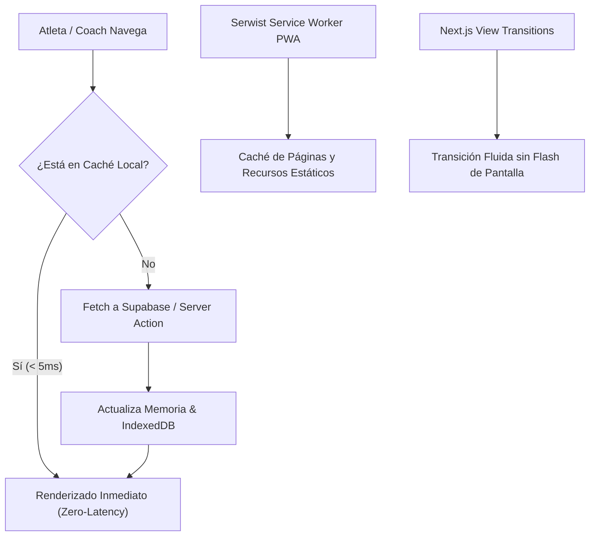

# Sistema Anatómico Biomecánico y Fusión con Open-Gym — RU Coach

## Resumen Ejecutivo

Este documento detalla la integración, arquitectura y componentes derivados de la fusión entre **RU Coach** y el proyecto de código abierto **Open-Gym**, adaptados a la identidad visual (`--primary` Dorado/Ámbar sobre carbón oscuro) y al flujo de trabajo de entrenamiento y asesoría personalizada de RU Coach.

El objetivo de esta fusión es dotar a la plataforma de:
1. **Analítica muscular y biomecánica profunda** (volumen efectivo ponderado, decaimiento de fatiga y retención de 1RM).
2. **Interactividad anatómica nativa** mediante gráficos SVG de precisión (`BodyMap`), permitiendo explorar ejercicios, auditar planes de entrenamiento y revisar la recuperación en tiempo real.
3. **Experiencia Mobile-First y Zero-Latency SPA**, eliminando tiempos de espera al navegar entre vistas y respondiendo a los requerimientos puntuales de entrenadores y atletas.

---

## 1. Arquitectura de Diseño y Estilo SVG (Por qué no verde)

### El Problema del Verde Fosforescente
En una adaptación previa, la silueta anatómica aplicaba clases como `fill-emerald-500` a todo el cuerpo o a músculos con `0%` de fatiga. Esto causaba que un atleta descansado o un usuario que recién entraba viera el cuerpo humano completamente verde fosforescente, desentonando con la estética premium de RU Coach.

### La Solución Auténtica de Open-Gym Adaptada a RU Coach
Inspirados en la implementación de Open-Gym (`open-gym/frontend/src/components/BodyMap.jsx` y `index.css`), se implementó la siguiente estructura en [`app/globals.css`](../app/globals.css):

```css
/* Base anatómica neutra */
:root {
  --bm-base: color-mix(in srgb, var(--foreground) 11%, var(--card));
  --bm-inert: color-mix(in srgb, var(--foreground) 18%, var(--card));
}
```

1. **Separación de Partes Inertes vs. Músculos Entrenables**:
   - `INERT` (`head`, `hair`, `neck`, `hands`, `feet`, `knees`, `ankles`): Utilizan la clase `.bm-sil` y se pintan con `--bm-inert`, manteniéndose siempre neutras.
   - `MUSCLES` (18 grupos musculares canónicos): Utilizan la clase base `.bm-m` y niveles de activación `.l0` a `.l4`.
2. **Líneas de Corte (Hairlines)**:
   - Los músculos contiguos están delimitados por `stroke: var(--card); stroke-width: 2.5; stroke-linejoin: round;`, creando bordes nítidos del color de fondo de la tarjeta.
3. **Rampa Tonal de Intensidad (Dorado RU Coach)**:
   - `.l0` (Descansado / Sin carga): Neutro absoluto (`var(--bm-base)`), **nunca verde**.
   - `.l1` a `.l4`: Progresión del color primario de la app usando `color-mix(in srgb, var(--primary) <32% | 56% | 78% | 100%>, var(--bm-base))`.
4. **Modos de Visualización Especializados**:
   - **Volumen (`mode="volume"`)**: Rampa dorada según series efectivas acumuladas.
   - **Fatiga (`mode="recovery"` / `.hm-fatigue`)**:
     - `.l0` (Descansado): Neutro base (`--bm-base`).
     - `.l1` a `.l4`: Progresión cálida (Dorado $\rightarrow$ Ámbar $\rightarrow$ Naranja $\rightarrow$ Rojo destructivo), alertando únicamente sobre músculos fatigados.
   - **Fuerza Retenida (`mode="strength"` / `.hm-strength`)**:
     - Rampa de 5 niveles que mapea desde el piso basal de fuerza (50%) hasta la retención plena (100%).
   - **Atención Clínica (`mode="clinical"` / `.hm-clinical`)**:
     - Resalta en rojo/ámbar las zonas anatómicas con dolor o molestia reportada por el asesorado.
5. **Selección de Alto Contraste**:
   - Al tocar cualquier músculo, la clase `.bm-m.sel` aplica un trazo destacado (`stroke: var(--foreground); stroke-width: 7;`) visible tanto en tema oscuro como claro.

---

## 2. Motor Biomecánico y Algorítmico

Los cálculos anatómicos se encuentran centralizados en [`lib/anatomy/`](../lib/anatomy/):

### A. Taxonomía y Ponderación Muscular ([`lib/anatomy/muscles.ts`](../lib/anatomy/muscles.ts))
- **18 Grupos Musculares Canónicos**: `trapezius`, `deltoids`, `chest`, `upper-back`, `serratus`, `biceps`, `triceps`, `forearm`, `abs`, `obliques`, `lower-back`, `gluteal`, `quadriceps`, `hamstring`, `adductors`, `hip-flexors`, `calves`, `tibialis`.
- **Cálculo de Volumen Ponderado (`getExerciseMuscleWeights` / `calculateMuscleLoad`)**:
  - Si el ejercicio cuenta con pesos específicos en `muscle_weights` (JSONB), se respeta dicha distribución.
  - De lo contrario, se asigna **1.0 (100%)** al músculo primario (`primary_muscle`) y **0.4 (40%)** a los músculos secundarios (`secondary_muscles`).
  - Ejemplo: Un Press de Banca otorga 3 series efectivas completas a `chest` y 1.2 series a `triceps` y `deltoids`.
- **Ranking y Umbrales (`rankOf` / `levelsOf`)**:
  - Separa los músculos trabajados ordenados por carga de aquellos sin estímulo directo (`missed`).
  - Permite evaluar si se cumplieron los objetivos semanales planificados.

### B. Decaimiento Biomecánico de Fatiga ([`lib/anatomy/recovery.ts`](../lib/anatomy/recovery.ts))
- **Vidas Medias Específicas por Músculo (`FATIGUE_HALF_LIFE_BY_MUSCLE`)**:
  - Músculos grandes/complejos (`lower-back`, `quadriceps`, `hamstring`, `gluteal`, `calves`): Vida media de recuperación de **48 horas**.
  - Torso superior (`chest`, `upper-back`, `trapezius`): Vida media de **30 horas**.
  - Músculos pequeños / recuperación rápida (`deltoids`, `biceps`, `triceps`, `abs`, `forearm`): Vida media de **24 horas**.
- **Fórmula de Decaimiento Acumulativo**:
  $$\text{Estímulo Inicial} = \frac{\text{Series Efectivas}}{8}$$
  $$\text{Fatiga Remanente} = \text{Estímulo Inicial} \times 0.5^{\frac{\Delta t}{\text{HalfLife}}}$$
  Saturando exponencialmente ante sesiones agrupadas para reflejar el cansancio sistémico y calculando con precisión las horas restantes para estar listo (`hoursToReady`).

### C. Retención de Fuerza y Desglose 1RM (`computeRetainedStrength`)
- **Piso de Retención (`STRENGTH_FLOOR = 0.5`)**: Un músculo desentrenado conserva como mínimo el 50% de su capacidad histórica.
- **Periodo de Retención Plena (`STRENGTH_FULL_MS = 14 días`)**: Tras una sesión de entrenamiento, la fuerza se conserva al 100% durante dos semanas completas.
- **Vida Media de Detraining (`STRENGTH_HALF_LIFE_MS = 28 días`)**: A partir del día 15 sin estímulo, la fuerza decae exponencialmente hacia el 50%.
- En la pestaña de fuerza, el sistema proyecta el 1RM estimado actual retenido para cada ejercicio registrado del músculo seleccionado.

---

## 3. Catálogo de Componentes Anatómicos

### 1. `BodyMap` ([`components/anatomy/body-map.tsx`](../components/anatomy/body-map.tsx))
Renderiza la silueta anatómica interactiva frontal y dorsal (o individual), con soporte para:
- `mode`: `"volume" | "recovery" | "strength" | "clinical"`
- `bare`: Modo compacto sin envoltura de tarjeta para embeberse en otros componentes.
- `selected`: Músculo seleccionado actualmente.
- `onSelect`: Callback al tocar un músculo o región.
- `gender` / `sex`: Vista masculina o femenina.

### 2. `MuscleBalanceCard` ([`components/anatomy/muscle-balance-card.tsx`](../components/anatomy/muscle-balance-card.tsx))
Tarjeta de analítica avanzada 3-en-1 portada de `open-gym`:
- **Pestaña 1: Balance Muscular**:
  - Filtro por periodo: `Semana`, `30d`, `90d`, `Todo`.
  - Navegación temporal por semanas (`< Esta semana >`).
  - Barras comparativas `.mrow`: Muestra las **series efectivas completadas vs. planificadas** en la rutina activa (iluminando la barra en verde cuando se cumple la meta semanal).
  - Chips `.mchip.miss`: Identifica los grupos musculares descuidados o sin estímulo en el periodo.
- **Pestaña 2: Fatiga**:
  - Mapa de calor de recuperación.
  - Indicador numérico de fatiga y horas restantes para entrenar de nuevo.
- **Pestaña 3: Fuerza Retenida**:
  - Desglose por grupo muscular con proyección de 1RM retenido vs. 1RM pico histórico y tiempo de inactividad.

### 3. `ActivityHeatmap` ([`components/anatomy/activity-heatmap.tsx`](../components/anatomy/activity-heatmap.tsx))
Mapa de actividad de 52 semanas consecutivas estilo GitHub:
- Shading de 5 niveles con la rampa dorada `.hm-c.l0..l4`.
- Selector de métrica: **Volumen total (kg)** o **Cantidad de sesiones/tiempo**.
- Desplazamiento automático al día actual y tooltips informativos por fecha.

### 4. `MuscleExplorerPanel` ([`components/anatomy/muscle-explorer-panel.tsx`](../components/anatomy/muscle-explorer-panel.tsx))
Explorador anatómico interactivo para filtrado de bibliotecas:
- Muestra el mapa corporal junto con 18 chips de músculos con conteo en vivo de ejercicios disponibles.
- Al seleccionar un músculo, filtra inmediatamente la lista y clasifica los ejercicios en:
  - **`Objetivo principal`**: El músculo seleccionado es el foco principal del movimiento (100% de carga).
  - **`También entrena`**: El músculo participa como sinergista o secundario (40% de carga).

### 5. `WeeklyMuscleCoverage` ([`components/anatomy/weekly-muscle-coverage.tsx`](../components/anatomy/weekly-muscle-coverage.tsx))
Componente liviano que combina:
- Miniatura de `BodyMap`.
- Leyenda visual de series.
- Desglose en barras horizontales `.mrow` de los músculos más trabajados.
- Chips de músculos sin trabajo directo.

---

## 4. Puntos de Integración en la Web

| Módulo / Ruta | Componente Integrado | Propósito / Beneficio |
| :--- | :--- | :--- |
| **Progreso del Asesorado**<br>`/client/progress` | `MuscleBalanceCard`<br>`ActivityHeatmap` | Permite al atleta auditar su balance muscular semanal frente a la rutina, vigilar la fatiga y ver su consistencia anual. |
| **Ficha del Asesorado (Coach)**<br>`/admin/clients/[clientId]` | `MuscleBalanceCard`<br>`ActivityHeatmap`<br>`WeeklyMuscleCoverage` | El coach revisa en la pestaña **Progreso** la adherencia y fuerza retenida del alumno, y en la pestaña **Rutina** la cobertura planificada. |
| **Constructor de Rutinas**<br>`/admin/routines/builder` | `WeeklyMuscleCoverage`<br>`MuscleExplorerPanel` | Cobertura muscular en vivo mientras se diseña el plan, y selector de ejercicios con mapa táctil ("Mapa Muscular"). |
| **Detalle de Rutina (Coach)**<br>`/admin/routines/[routineId]` | `WeeklyMuscleCoverage` | Muestra la distribución anatómica del programa completo con ranking de series efectivas. |
| **Mis Planes (Asesorado)**<br>`/client/routines` | `WeeklyMuscleCoverage` | Sección *"Qué trabaja esta sesión"* antes de comenzar el entrenamiento del día. |
| **Catálogo de Ejercicios**<br>`/admin/exercises` | `BodyMap`<br>18 chips musculares | Botón *"Mapa"* en la barra lateral para filtrar la base de datos de ejercicios por grupo anatómico. |
| **Resumen Post-Entreno**<br>`/client/workout/summary` | `WeeklyMuscleCoverage` | Muestra al finalizar la sesión los *"Músculos trabajados hoy"* basándose en las series efectivas completadas. |

---

## 5. Requerimientos Mobile-First y UX del Cliente

Durante la integración se incorporaron tres requerimientos clave solicitados para optimizar el uso en dispositivos móviles:

### 1. Rutinas Continuas (`duration_weeks = null`)
- **Problema**: El formulario exigía definir semanas fijas de duración, lo que generaba confusión en atletas cuyos programas duran lo que dura su membresía.
- **Solución**:
  - Se habilitó la opción de **"Rutina continua (sin semanas fijas)"** tanto en el selector como al limpiar el campo.
  - En la vista del atleta (`/client/routines`), si la rutina es continua se oculta la barra de progreso de semanas fijas y se muestra la insignia *"Rutina continua activa"*, dependiendo únicamente de la vigencia de la suscripción.

### 2. Series de Aproximación (Warm-up / Feeder Sets)
- **Problema**: La tarjeta del ejercicio solo contemplaba series efectivas de trabajo (ej. 3x10-12), sin espacio para registrar calentamiento o aproximaciones sin distorsionar el volumen total.
- **Solución**:
  - **En el Builder**: Campo opcional de *"Series de aproximación"* (ej. `1x12 al 50%, 1x8 al 70%`).
  - **En la Sesión Activa (`/client/workout/start`)**: Soporte para marcar series como calentamiento (`is_warmup: true`).
  - **En Analítica**: Las series de aproximación se excluyen automáticamente del volumen total efectivo (`total_volume_kg`), del conteo de PRs y del cálculo de fatiga para evitar distorsiones en los récords del atleta.

### 3. Ajustes de Layout y Espaciado en Móvil
- **Problema**: Nombres largos de ejercicios se truncaban con puntos suspensivos (ej. "3/4 sit-up" se leía "3..."), y los botones de acción rápida quedaban cortados contra el borde de la pantalla.
- **Solución**:
  - Reestructuración de tarjetas en dos filas responsivas:
    - **Fila superior**: Miniatura, nombre completo del ejercicio (permitiendo salto de línea) y tags de músculos/equipo con `flex-wrap`.
    - **Fila inferior**: Controles de series, repeticiones, descanso y botones de acción rápida con separación amplia y padding seguro.
  - Viewport de selección (`SelectContent`) limitado a `max-h-[min(24rem,var(--radix-select-content-available-height,80vh))]` para evitar desbordamientos en pantallas pequeñas con teclado virtual.

---

## 6. Rendimiento Zero-Latency SPA (App Nativa)

Para que la aplicación se sienta instantánea sin contar con un backend monolítico tradicional, se implementó una arquitectura de 3 capas:



1. **Service Worker PWA (`app/sw.ts`)**:
   - Cacheo mediante estrategias Stale-While-Revalidate para rutas clave (`/client/*`, `/admin/*`).
   - Soporte de funcionamiento sin conexión y sincronización en segundo plano.
2. **Caché en Memoria y Almacenamiento Local (`lib/local-cache.ts`)**:
   - Cacheo del catálogo de ejercicios y borradores de rutinas, permitiendo abrir selectores y modales en 0 milisegundos.
3. **Prefetching y View Transitions (`next.config.mjs` / `components/mobile-bottom-nav.tsx`)**:
   - Transiciones nativas habilitadas con `viewTransition: true`.
   - Precarga automática de rutas adyacentes al hacer hover o al montar la barra de navegación inferior.

